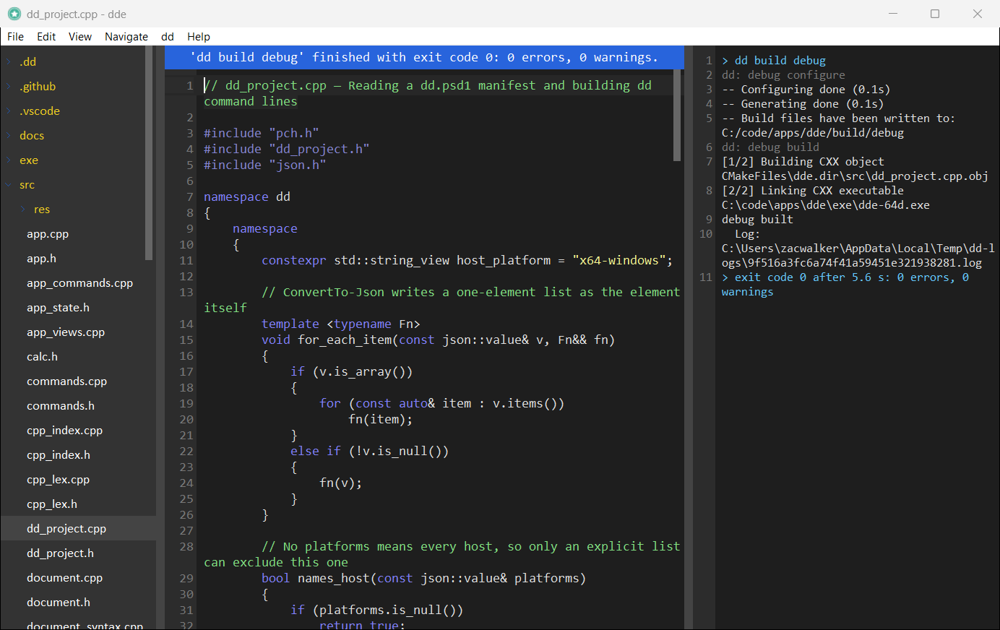

# dde

[](https://github.com/ZacWalk/dde/actions/workflows/build.yml)

dde, the editor for [dd](https://github.com/ZacWalk/dd) projects. Open a folder
that dd builds, edit it, and build, test, run and launch it from the keyboard,
with the output streaming into a pane beside the code and every error one key
away. It is written in C++20 on [libdesktop](https://github.com/ZacWalk/libdesktop)
and needs nothing third-party.



*dde with its own repository open: a source file in the editor and `dd build debug` in the Output pane.*

## Features

- **dd built in** — Build (`F7`), Test (`Ctrl+Shift+T`), Run (`Ctrl+F5`) and Launch (`Ctrl+Shift+F5`) from the **dd** menu, with the configuration, the test label, every target and the project's own `dd.psd1` commands a click away. `dd.psd1` is read as data; nothing runs because a folder was opened
- **Output pane** — the running command's output, live (`Ctrl+Shift+U`); double-click an error, or press `F8` / `Shift+F8`, to go to its file, line and column
- **Folder browser** — navigate a root folder; create, rename and delete files inline
- **Multi-file search** — live search across the folder, grouped by file with highlighted matches (`Ctrl+Shift+F`)
- **Four document views** — text, Markdown, CSV table and hex, chosen automatically and remembered per file
- **Syntax highlighting** — C++, Rust, Python, PowerShell and Markdown
- **C/C++ navigation** — go to definition (`F12`), switch header/source (`Ctrl+F12`), and navigation history (`Alt+Left` / `Alt+Right`), using a lightweight lexical index rather than a compiler
- **Editing** — unlimited undo, word wrap, indent/unindent, spell check
- **Utilities** — JSON reformat (`Ctrl+R`), sort and de-duplicate lines, evaluate a selected expression (`Ctrl+E`)
- **Session memory** — restores the recent root folders and the last document open in each

Open documents are never closed behind your back: unsaved files stay in memory with their full undo history and are shown in red. You are prompted to save only when changing folder, exiting, or running a dd command.

dd itself needs [PowerShell 7.4](https://github.com/PowerShell/PowerShell) (`pwsh`) on `PATH`; without it, or without a `dd.ps1` in the folder, the dd menu says so and stays disabled.

## Building

Requires Windows x64 and Visual Studio with the Desktop C++ workload. The
vendored [dd](https://github.com/ZacWalk/dd) runtime locates Visual Studio and
uses the CMake and Ninja that ship with it.

```powershell
.\dd.ps1 build              # both configurations
.\dd.ps1 test --label unit  # the unit tests, in both configurations, without a window
.\dd.ps1 test --label headless # the common no-visible-UI gate, with console case counts
.\dd.ps1 launch             # build Release, then start dde and leave it running
```

`unit` and `dde` remain supported labels. Test presets show passing-test output
too. After building, `ctest --preset debug -L headless -V --no-tests=error`
reruns the suite without rebuilding; use `release` for Release. For a direct
GUI-executable test, pipe both streams so PowerShell waits:
`& .\exe\dde-64.exe /test 2>&1 | Out-Host; $LASTEXITCODE`.

Output is `exe\dde-64.exe`, or `dde-64d.exe` for Debug. Neither `run` nor
`launch` closes an already-running copy, so close the app before rebuilding its
executable — or build the other configuration from inside it.

[libdesktop](https://github.com/ZacWalk/libdesktop) comes from a sibling
`..\libdesktop` checkout when there is one; a clean clone fetches the `GIT_TAG`
pinned in `CMakeLists.txt`.

### Icon

`python tools\generate_icon.py` regenerates `src\res\app.ico` from the teal
circular badge and three text-line vectors, in nine desktop sizes. Add `--check`
to verify without writing,
or `--output tmp\icon-128.png --size 128` to export another size.
Python 3.9+'s standard library and the vendored `tools\iconlib.py` are sufficient;
no sibling checkout, font or graphics package is required.
`python -B -m unittest discover -s tools -p test_generate_icon.py` checks the
badge, text-line legibility and generated resource at all nine sizes.

## Documentation

- [docs/design.md](docs/design.md) — architecture, panes, dd integration, keyboard, configuration and limitations
- [docs/cpp.md](docs/cpp.md) — the lexical C/C++ index behind go-to-definition
- [AGENTS.md](AGENTS.md) — rules for contributors and coding agents

## License

[MIT](LICENSE). The executable includes
[libdesktop](https://github.com/ZacWalk/libdesktop), which is licensed under the
Mozilla Public License 2.0: anyone distributing the executable must tell its
recipients where to get libdesktop's source code, including any changes made to
it. `tools/iconlib.py` is vendored from libdesktop under the same licence.
